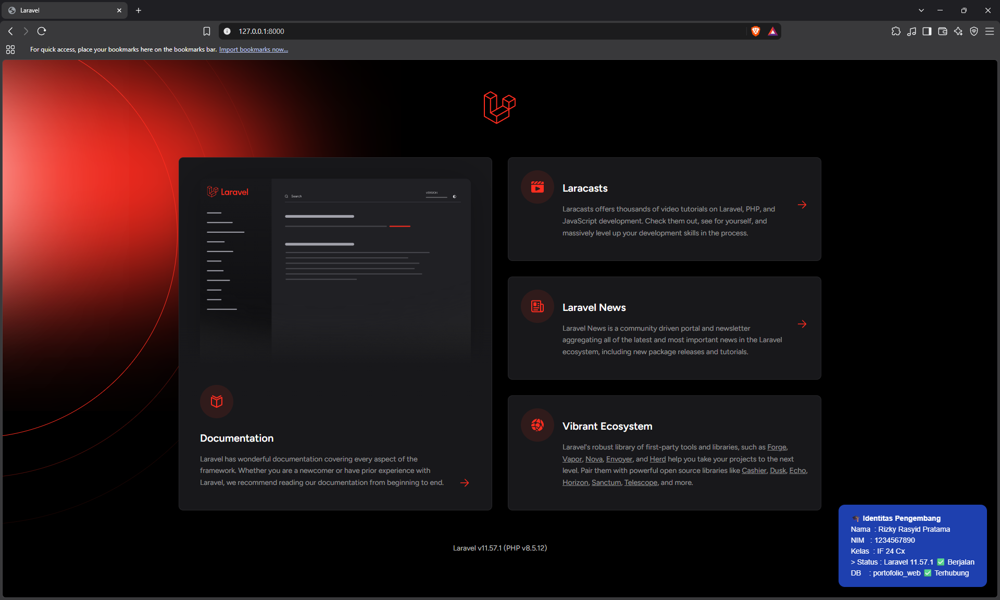

# Latihan 4a: Setup Laravel & Konfigurasi MySQL

Studi kasus: Website Portofolio Mahasiswa

## Identitas

|       |                      |
| ----- | -------------------- |
| Nama  | Rizky Rasyid Pratama |
| NPM   | 24312116             |
| Kelas | IF 24 Cx             |

## Screenshot

Halaman welcome Laravel dengan kartu identitas dan nama database aktif (`portofolio_web`).



## Versi yang Dipilih

| Komponen | Versi                                                 |
| -------- | ----------------------------------------------------- |
| PHP      | 8.5.12                                                |
| Laravel  | 11.57.1                                               |
| Database | MariaDB (bawaan XAMPP), diakses dengan driver `mysql` |

> Catatan: PHP yang terpasang adalah 8.5.12 (bawaan XAMPP). Laravel 11 tetap berjalan normal di versi ini.

## Folder Penting Laravel

| Folder / File           | Fungsi                                                                    |
| ----------------------- | ------------------------------------------------------------------------- |
| `app/Http/Controllers/` | Tempat logika pemrosesan request (Controller di MVC).                     |
| `app/Models/`           | Representasi tabel database (Model di MVC).                               |
| `resources/views/`      | Template Blade untuk tampilan (View di MVC).                              |
| `routes/web.php`        | Definisi rute untuk halaman web.                                          |
| `database/migrations/`  | Skrip pembuatan dan perubahan struktur tabel.                             |
| `config/`               | File konfigurasi aplikasi (database, mail, dll).                          |
| `public/`               | Root server; `index.php` adalah pintu masuk aplikasi.                     |
| `bootstrap/app.php`     | Pusat konfigurasi aplikasi dan middleware (Laravel 11).                   |
| `.env`                  | Konfigurasi lingkungan seperti kredensial database. Tidak di-push ke Git. |

## Perintah Artisan yang Akan Digunakan

| Perintah                                     | Fungsi                                                  |
| -------------------------------------------- | ------------------------------------------------------- |
| `php artisan serve`                          | Menjalankan server pengembangan lokal.                  |
| `php artisan migrate`                        | Membuat tabel di database dari file migration.          |
| `php artisan migrate:status`                 | Melihat status setiap migration (Ran/Pending).          |
| `php artisan migrate:fresh`                  | Menghapus semua tabel lalu migrate ulang dari awal.     |
| `php artisan make:model NamaModel`           | Membuat file Model baru.                                |
| `php artisan make:controller NamaController` | Membuat file Controller baru.                           |
| `php artisan route:list`                     | Menampilkan semua rute yang terdaftar.                  |
| `php artisan config:clear`                   | Membersihkan cache konfigurasi setelah mengubah `.env`. |

## Cara Menjalankan

```bash
git clone https://github.com/rizkyrasyidpratama/portofolio.git
cd portofolio
git checkout lat4a-backend-setup-laravel
composer install
cp .env.example .env
php artisan key:generate
# sesuaikan DB_DATABASE, DB_USERNAME, DB_PASSWORD di .env
php artisan migrate
php artisan serve
```

Buka `http://127.0.0.1:8000`.

Catatan untuk pengguna XAMPP (MariaDB): `.env.example` sudah menyertakan
`DB_COLLATION=utf8mb4_unicode_ci` agar migrasi tidak gagal karena collation `utf8mb4_0900_ai_ci`.
